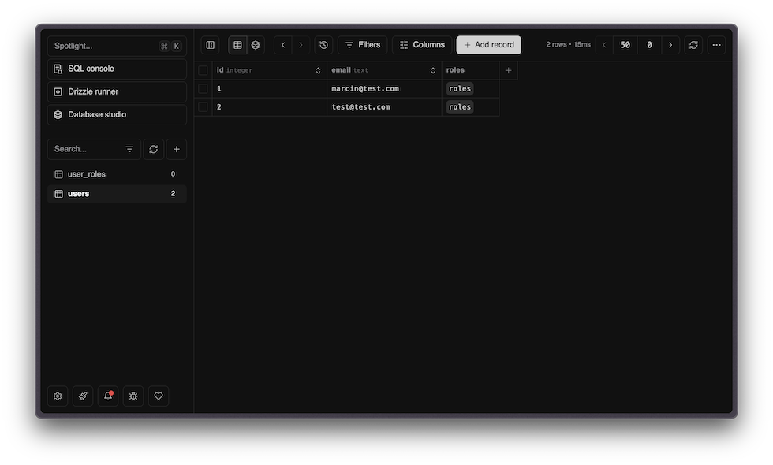

import { Steps, FileTree } from "@astrojs/starlight/components"

Database integration with **[Cloudflare D1](https://developers.cloudflare.com/d1/)** (SQLite) and **[Drizzle ORM](https://orm.drizzle.team/)**. Pre-configured for local development, migrations, and production deployment.

**Key features**

- SQLite database running on Cloudflare's edge
- Type-safe queries with Drizzle ORM
- Automatic migration generation
- Visual database browser with Drizzle Studio
- Separate databases for production and preview

## Database Commands

```bash
bun run db:studio           # Open visual database browser
bun run db:generate         # Generate migrations from schema changes
bun run db:migrate --local  # Apply migrations locally
bun run db:reset            # Delete all migrations and regenerate from scratch
```

## Accessing the Database

Use `getMainDb()` from `@/db/main` to access the Drizzle ORM instance. Call it inside server functions:

```tsx
import { createServerFn } from "@tanstack/react-start"
import { getMainDb } from "@/db/main"
import { user } from "@/db/main/schema"

const listUsers = createServerFn({ method: "GET" }).handler(async () => {
  const db = getMainDb()
  return db.select().from(user).all()
})
```

The `db` object is a Drizzle ORM instance with full TypeScript support.

## Schema Definition

Database schemas are defined in feature modules and then aggregated at `packages/db/main/`:

<FileTree>

- apps/
  - auth/db/schema.ts Better Auth tables (user, session, account, verification)
  - newsletter/db/schema.ts Newsletter tables
- packages/db/
  - main/
    - schema.ts Main database schema
    - migrations/ Generated SQL migrations

</FileTree>

**Example schema:**

```tsx
import { sqliteTable, text, integer } from "drizzle-orm/sqlite-core"

export const user = sqliteTable("user", {
  id: text("id").primaryKey(),
  name: text("name").notNull(),
  email: text("email").notNull().unique(),
  emailVerified: integer("email_verified", { mode: "boolean" }).default(false).notNull(),
  role: text("role").default("user"),
})
```

## Adding a New Table

<Steps>

1. Create or update a schema file in your feature's `db/` folder:

   ```tsx
   // apps/blog/db/schema.ts
   import { integer, sqliteTable, text } from "drizzle-orm/sqlite-core"

   export const posts = sqliteTable("posts", {
     id: integer("id").primaryKey(),
     title: text("title").notNull(),
     content: text("content"),
   })
   ```

1. Export it from `packages/db/main/schema.ts`:

   ```ts
   export * from "@/blog/db/schema"
   ```

1. Generate a migration:

   ```bash
   bun run db:generate
   ```

1. Apply the migration locally:

   ```bash
   bun run db:migrate --local
   ```

</Steps>

The migration is automatically applied in CI/CD when you push your changes.

## Multiple Databases

The database package is structured to support multiple D1 databases. Each database configuration entry point lives under its own subdirectory in `packages/db/`, named after the binding (minus the `DB_` prefix and lowercased). The main database is at `packages/db/main/` - corresponding to the `DB_MAIN` binding - but additional databases can be added following the same pattern, e.g. `packages/db/secondary/` for a `DB_SECONDARY` binding.

<Steps>

1. Create the new database in Cloudflare:

   ```sh
   bunx cf d1 create --name <project-name>-secondary-production
   ```

   ```sh
   bunx cf d1 create --name <project-name>-secondary-preview
   ```

1. Add it to the `d1` array in `packages/config/cloudflare` for each mode (`binding`, `name`, `id`, `migrationsDir`):

   ```ts
   // packages/config/cloudflare/production.ts
   d1: [
     {
       binding: "DB_MAIN",
       name: `${workerName}-production`,
       id: "your-production-db-main-uuid",
       migrationsDir: "./packages/db/main/migrations",
     },
     {
       binding: "DB_SECONDARY",
       name: `${workerName}-secondary-production`,
       id: "your-production-db-secondary-uuid",
       migrationsDir: "./packages/db/secondary/migrations",
     },
   ]
   ```

   Preview, development, and e2e spread and override the same array. Local development needs a UUID v4 persist id (`cf` rejects Wrangler's `<DATABASE_ID>` placeholder). Keep `DB_MAIN` as a static binding in `cloudflare.config.ts` (spread-only D1s are missing from `Env`); add a static `bindings.d1()` entry there for `DB_SECONDARY` as well:

   ```ts
   // cloudflare.config.ts worker.env
   DB_SECONDARY: bindings.d1({ name: dbSecondary.name, id: dbSecondary.id }),
   DB_MAIN: bindings.d1({ name: dbMain.name, id: dbMain.id }),
   ```

1. Create the schema and db server files:

   ```ts
   // packages/db/secondary/schema.ts
   import { integer, sqliteTable, text } from "drizzle-orm/sqlite-core"

   export const posts = sqliteTable("posts", {
     id: integer("id").primaryKey(),
     title: text("title").notNull(),
   })
   ```

   ```ts
   // packages/db/secondary/db.server.ts
   import { env } from "cloudflare:workers"
   import { drizzle } from "drizzle-orm/d1"
   import * as schema from "./schema"

   export function getSecondaryDb() {
     return drizzle(env.DB_SECONDARY, { schema })
   }
   ```

1. Generate and apply migrations for the new database:

   ```sh
   DB_BINDING=DB_SECONDARY bun run db:generate
   DB_BINDING=DB_SECONDARY bun run db:migrate --local
   ```

</Steps>

## Drizzle Studio

Browse and edit your database visually:

```bash
bun run db:studio
```

Opens at [local.drizzle.studio](https://local.drizzle.studio) where you can:

- View all tables and their data
- Run queries
- Edit records directly
- Explore relationships


